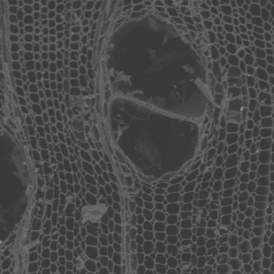
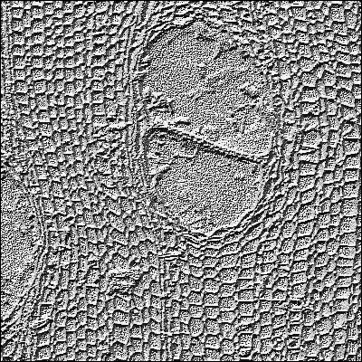
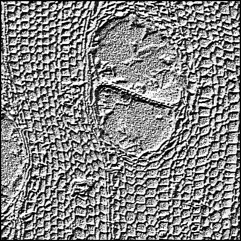

# Classificação de espécies de madeira com LBP e kNN

Dois programas em **C (C11)** que, juntos, formam um pipeline de classificação de texturas:

1. **[`lbp`](lbp/README.md)** lê imagens em tons de cinza no formato PGM (P2/P5) e extrai de cada uma o histograma do descritor **Local Binary Pattern**, nas variantes LBP(8,1) e LBP(16,2).
2. **[`knn`](knn/README.md)** recebe os histogramas de uma base de treinamento e de uma base de teste e classifica cada imagem de teste com **k-Nearest Neighbors** (distância Euclidiana), com normalização Min-Max ou Z-Score opcional.

```
imagens .pgm ──► lbp ──► treinamento.txt / teste.txt ──► knn ──► acurácia
```

| Imagem original | LBP(8,1) | LBP(16,2) |
|:---:|:---:|:---:|
|  |  |  |

Com uma base de 6000 imagens microscópicas de madeira de 15 espécies (3000 para treinamento e 3000 para teste), LBP(8,1) e `k = 5`:

| Normalização | Acurácia |
|---|---|
| Sem normalização | 82.1% |
| Min-Max | 85.4% |
| Z-Score | 85.2% |

> Projeto desenvolvido na disciplina CI1002 – Programação 2 do Bacharelado em Ciência da Computação da UFPR.

## Estrutura

```
.
├── Makefile        compila os dois programas e executa o pipeline
├── lbp/            extrator de características LBP
│   ├── README.md
│   ├── docs/img/
│   └── src/
├── knn/            classificador kNN
│   ├── README.md
│   └── src/
├── bin/            (gerado) executáveis lbp e knn
└── data/           (não versionado) imagens e arquivos de características
```

## Como usar

Requisitos: `gcc`, `make` e um sistema POSIX (Linux ou macOS).

```bash
make              # compila os dois programas em bin/
```

A base de imagens foi fornecida pela disciplina e **não faz parte do repositório**. Para rodar o pipeline completo, coloque as imagens assim:

```
data/
├── treinamento/    imagens .pgm de treinamento
└── teste/          imagens .pgm de teste
```

A classe de cada imagem é o prefixo do nome do arquivo antes do primeiro dígito (por exemplo, `Apuleia_201.pgm` pertence à classe `Apuleia_`).

```bash
make pipeline                      # extrai os histogramas e classifica (LBP(8,1), k = 5, Min-Max)
make pipeline K=3 NORM=z-score     # outros parâmetros
make classifica NORM=              # só o kNN, sem normalização, sobre os .txt já gerados
```

Os programas também podem ser usados separadamente:

```bash
./bin/lbp -d data/treinamento -n 8 -o data/treinamento.txt
./bin/lbp -d data/teste       -n 8 -o data/teste.txt
./bin/knn -t data/treinamento.txt -v data/teste.txt -k 5 -n min-max -d
```

Os detalhes de cada programa (opções, formato dos arquivos, arquitetura, decisões de projeto e limitações) estão em [`lbp/README.md`](lbp/README.md) e [`knn/README.md`](knn/README.md).
