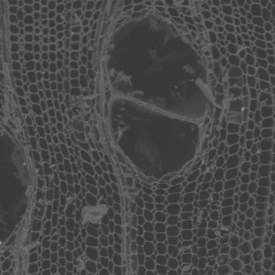
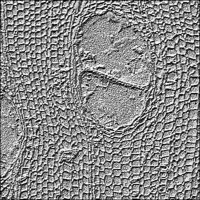
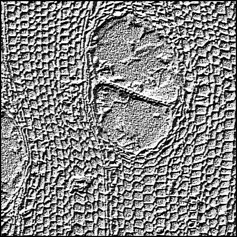

# lbp: extrator de características LBP para imagens PGM

Programa em C (C11) que lê imagens em tons de cinza no formato **PGM (P2 e P5)**, calcula o descritor de textura **Local Binary Pattern (LBP)** nas variantes **LBP(8,1)** e **LBP(16,2)** e gera um histograma de características para cada imagem. Os histogramas servem de entrada para o classificador [`knn`](../knn/README.md). Opcionalmente, o programa também grava a imagem LBP de cada entrada.

| Imagem original | LBP(8,1) | LBP(16,2) |
|:---:|:---:|:---:|
|  |  |  |

*Amostra da espécie* Cecropia *(400×400). Na imagem LBP(16,2), os códigos foram divididos por 257 apenas para visualização.*

## Sumário

- [Destaques](#destaques)
- [Compilação](#compilação)
- [Uso](#uso)
- [Formato da saída](#formato-da-saída)
- [Como o LBP funciona](#como-o-lbp-funciona)
- [Arquitetura](#arquitetura)
- [Decisões de projeto](#decisões-de-projeto)
- [Tratamento de erros](#tratamento-de-erros)
- [Validação e desempenho](#validação-e-desempenho)
- [Limitações conhecidas](#limitações-conhecidas)

## Destaques

- **Leitor PGM completo**: P2 (texto) e P5 (binário, 1 ou 2 bytes por pixel, big-endian), com suporte a comentários `#` em qualquer ponto do cabeçalho e validação de cada pixel no intervalo `[0, MAXVAL]`.
- **Ponteiro para função** (`LBPFunction`) seleciona a variante uma única vez, sem desvios no laço principal.
- **Tabelas de deslocamento** (`dx`/`dy`): uma única função genérica calcula as duas variantes.
- **Sem limites fixos** no número de imagens: a lista de arquivos cresce com `realloc`.
- **Uso de memória constante**: as imagens são processadas uma de cada vez.
- **Saída determinística**: os arquivos são processados em ordem alfabética.
- **Sem vazamentos de memória** (verificado com AddressSanitizer, LeakSanitizer e UBSan) e **sem warnings** com `-Wall -Wextra -Wpedantic -std=c11`.

## Compilação

Requisitos: `gcc`, `make` e um sistema POSIX (Linux ou macOS).

```bash
cd lbp/src
make            # compila e instala o executável em bin/lbp (na raiz do repositório)
make exemplo    # roda LBP(8,1) e LBP(16,2) nas imagens de data/amostras/
make limpa      # remove os arquivos objeto
make faxina     # remove tudo o que foi gerado (objetos, executável, resultados)
```

O alvo `make exemplo` espera imagens `.pgm` em `data/amostras/` e grava `resultados/lbp8.txt`, `resultados/lbp16.txt` e as imagens LBP em `resultados/lbp8/` e `resultados/lbp16/`.

Também é possível compilar a partir da raiz do repositório com `make` (veja o [README principal](../README.md)).

## Uso

```
./bin/lbp -d <diretorio> -n <vizinhos> -o <arquivo_saida> [-i <diretorio_imagens>]
```

| Opção | Descrição |
|---|---|
| `-d` | Diretório com as imagens `.pgm` |
| `-n` | Número de vizinhos: `8` para LBP(8,1) ou `16` para LBP(16,2) |
| `-o` | Arquivo texto onde os histogramas serão gravados |
| `-i` | *(opcional)* Diretório onde as imagens LBP serão geradas (criado se não existir) |
| `-h` | Mostra a ajuda |

As opções podem aparecer em qualquer ordem:

```bash
./bin/lbp -d data/treinamento -n 8 -o data/treinamento.txt
./bin/lbp -n 16 -o caracteristicas.txt -d data/amostras -i imagens_lbp
```

## Formato da saída

O arquivo indicado em `-o` tem uma linha por imagem, com campos separados por espaço:

```
nome largura altura vizinhos h[0] h[1] ... h[N-1]
```

- `N = 256` para LBP(8,1) e `N = 65536` para LBP(16,2);
- `h[k]` é o número de pixels da imagem cujo código LBP é `k`.

Exemplo (truncado):

```
Apuleia_201.pgm 400 400 8 8495 824 1465 885 1164 163 1067 1184 1553 887 ...
```

As imagens LBP são gravadas em PGM P5 com `MAXVAL = 255` e o mesmo nome do arquivo original.

## Como o LBP funciona

Cada vizinho `Pi` do pixel central `C` gera um bit `bi`, que vale 1 se `Pi ≥ C` e 0 caso contrário. O código do pixel é

```
LBP = Σ bi · 2^i
```

**LBP(8,1)**: os 8 vizinhos imediatos, com código em `[0, 255]`.

```
P0 P1 P2
P3 C  P4
P5 P6 P7
```

Por exemplo, na vizinhança `6 5 2 / 7 [6] 1 / 9 3 7` os bits ligados são P0, P3, P5 e P7, e o código é `1 + 8 + 32 + 128 = 169`.

**LBP(16,2)**: a borda de uma janela 5×5 (16 vizinhos), com código em `[0, 65535]`.

```
P0  P1  P2  P3  P4
P5              P6
P7      C       P8
P9              P10
P11 P12 P13 P14 P15
```

Pixels a menos de `raio` pixels da borda da imagem não têm todos os vizinhos. Eles não são processados e recebem código 0.

## Arquitetura

```
src/
├── main.c          coordena o processamento
├── argumentos.c/h  interpretação da linha de comando (getopt)
├── diretorio.c/h   listagem dos arquivos .pgm de um diretório
├── pgm.c/h         leitura de imagens P2/P5 (estrutura PGMImage)
├── lbp.c/h         cálculo dos códigos LBP e dos histogramas
├── saida.c/h       gravação do arquivo de características e das imagens LBP
└── Makefile
```

### Fluxo

```
argumentos ──► diretório ──► para cada .pgm:
                               le_PGM ──► calcula_imagem_LBP ──► calcula_histograma
                                                │                       │
                                                ▼                       ▼
                                       grava_imagem_LBP (-i)   escreve_caracteristicas
                               libera a memória e passa para a próxima imagem
```

### Estruturas de dados

```c
typedef struct {
    int largura, altura, maxval;
    int** pixels;              // pixels[linha][coluna]
} PGMImage;

typedef uint16_t (*LBPFunction)(const PGMImage* imagem, int x, int y);

typedef struct {
    int vizinhos;              // 8 ou 16
    int raio;                  // 1 ou 2
    int bins;                  // 256 ou 65536
    LBPFunction funcao;        // lbp8_pixel ou lbp16_pixel
} ConfigLBP;
```

- **Matriz em bloco contíguo**: `pixels` é um vetor de ponteiros para linhas que apontam para um único bloco de `largura × altura` inteiros. O acesso continua sendo `pixels[y][x]`, mas cada imagem exige só duas alocações, o que melhora a localidade de cache e simplifica a liberação.
- **`ConfigLBP`** reúne tudo o que varia entre as variantes. Uma nova variante precisa apenas de uma tabela de deslocamentos e de um novo caso em `configura_LBP`.
- **Códigos em `uint16_t`**, que comporta os dois intervalos (`0–255` e `0–65535`).
- **Histograma alocado com `calloc`**, que já entrega a memória zerada.

## Decisões de projeto

| Decisão | Alternativa | Motivo |
|---|---|---|
| Processar uma imagem por vez | Abrir todos os arquivos antes de processar | Mantém a memória constante e não esbarra no limite de descritores de arquivo do sistema (normalmente 1024). |
| Lista de nomes com `realloc` | Vetor de tamanho fixo | Aceita qualquer quantidade de imagens sem descartar arquivos silenciosamente. |
| Função genérica com tabelas `dx`/`dy` | Comparações escritas à mão para cada vizinho | Menos código repetido e menos chance de erro de índice. |
| Bits com `1u << i` | `pow(2, i)` | Evita aritmética de ponto flutuante e a dependência de `-lm`. |
| Imagens LBP em P5 | P2 (texto) | Arquivos cerca de 4× menores (160 KB contra cerca de 600 KB por imagem). |
| Ordenar os nomes com `qsort` | Ordem do `readdir` | Saída reproduzível em qualquer sistema de arquivos. |
| Leitor de cabeçalho próprio | `fscanf` | O `fscanf` não trata comentários `#` nem permite validar o único byte de espaço exigido antes dos dados P5. |
| Lista de arquivos montada uma única vez | Percorrer o diretório a cada etapa | Garante que cada histograma fique associado ao nome correto. |
| `_POSIX_C_SOURCE 200809L` nos módulos POSIX | Compilar com `-std=gnu11` | Mantém o código em C11 padrão e declara explicitamente as APIs POSIX usadas (`getopt`, `opendir`, `mkdir`). |

## Tratamento de erros

As mensagens de erro vão para `stderr`, e o programa termina com código diferente de zero em caso de falha. Os casos tratados são:

- opção desconhecida, opção sem argumento ou argumento sobrando;
- `-d`, `-n` ou `-o` ausentes;
- valor inválido para `-n` (aceita apenas `8` ou `16`; `8x` é rejeitado);
- diretório inexistente ou sem nenhum `.pgm`;
- falha ao abrir uma imagem ou ao criar o arquivo de saída ou o diretório `-i`;
- arquivo que não é PGM, formato não suportado (por exemplo `P3`), cabeçalho inválido, dados truncados ou pixel maior que `MAXVAL`;
- falha de alocação de memória.

Uma imagem inválida não interrompe o processamento das demais. Ela é informada e ignorada, e ao final o programa mostra quantas imagens foram processadas com sucesso:

```
$ ./bin/lbp -n 7 -d data/amostras -o saida.txt
Erro: valor invalido para -n ('7'). Valores permitidos: 8 ou 16.

$ ./bin/lbp -d imagens -n 16 -o saida.txt
Erro: formato PGM desconhecido 'P3' em 'imagens/p3.pgm' (formatos aceitos: P2 e P5).
Erro: dados da imagem 'imagens/trunc.pgm' incompletos ou fora do intervalo [0, 255].
1 de 3 imagens processadas com sucesso.
```

## Validação e desempenho

- **Correção**: histogramas e imagens LBP das duas variantes foram comparados, valor a valor, com uma implementação de referência independente em Python, sem divergências.
- **Desempenho**: 3000 imagens de 400×400 processadas em cerca de 75 s com LBP(8,1) e cerca de 2 min 40 s com LBP(16,2), incluindo a gravação das imagens LBP e sem otimização do compilador (`-O0`). No LBP(16,2), a maior parte do tempo é gasta escrevendo os 65536 valores de cada linha da saída.
- **Memória**: execução com `-fsanitize=address,undefined` sem erros nem vazamentos, inclusive com entradas inválidas.
- **Entradas inválidas**: todos os casos de [Tratamento de erros](#tratamento-de-erros) foram testados, incluindo P2 com comentários no meio do cabeçalho e P5 de 16 bits.

## Limitações conhecidas

- **Pixels de borda no histograma**: os pixels de borda recebem código 0 e são contados em `h[0]`, que fica inflado em `2·r·(largura + altura) − 4·r²` pixels (1596 no LBP(8,1) e 3184 no LBP(16,2) para imagens 400×400). Para excluí-los, basta percorrer só a região interna em `calcula_histograma`.
- **Saída grande no LBP(16,2)**: cada linha tem 65540 campos, quase todos zero. Um formato esparso seria muito menor, mas o formato denso mantém a compatibilidade com o `knn`.
- **Nomes de arquivo com espaços** são gravados como estão e quebram a separação de campos da saída.
- Só são considerados arquivos com extensão `.pgm` (sem diferenciar maiúsculas de minúsculas), e subdiretórios não são percorridos.
